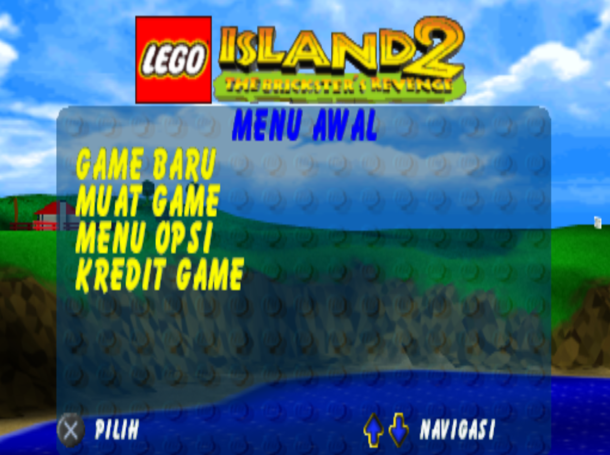

# LEGO Island 2: The Brickster's Revenge (PS1) - Indonesian Translation

Unofficial Indonesian fan translation for *LEGO Island 2: The Brickster's Revenge* (PlayStation, LEGO Media / Silicon Dreams Studio).

The patch rewrites the in-game subtitle and menu text stored in `PSXFILE` in place. File size, sector layout and line structure are unchanged, so the result can be re-imported into the disc image without rebuilding the filesystem.



## Contents

- [Screenshots](#screenshots)
- [Status](#status)
- [Requirements](#requirements)
- [Compatibility](#compatibility)
- [Usage](#usage)
- [Translation file format](#translation-file-format)
- [PSXFILE text format](#psxfile-text-format)
- [Translation constraints](#translation-constraints)
- [Contributing](#contributing)
- [Known issues](#known-issues)
- [Credits](#credits)
- [Legal](#legal)

## Screenshots

| Original | Translated |
|:---:|:---:|
|  |  |
|  |  |
|  |  |
|  |  |

## Status

| Component | Status |
|---|---|
| Character dialogue, hints and mini-game commentary (1,519 lines that carry a sound ID) | Translated |
| Mini-game results and control labels | Translated |
| Menus, options, pause menu, level names | Translated |
| Memory card messages | Translated |
| Information Center and character cards (job titles) | Translated |
| Credits (job titles only) | Translated |
| Proper nouns, crew names, skateboard trick names, debug labels | Left in English |
| FMV subtitles | Not applicable (not in this file) |
| Text stored as graphics (titles, logos) | Not translated |

1,882 of 2,181 lines are modified. The remaining 299 are names, labels and terms intentionally kept as-is, plus one empty line.

## Requirements

- A legitimate copy of the game, dumped to `.bin/.cue`
- Python 3.8+ (for the script method)
- A tool that can extract and replace a file inside a PS1 image without changing its size (e.g. CDMage, `dumpsxiso`)
- An emulator (DuckStation or similar) or modded hardware

## Compatibility

Developed against a `PSXFILE` with the following properties. Other regions or revisions are untested.

```
Size    : 31,504,384 bytes
MD5     : 08808a444d795937184bba0af759074b
SHA-1   : ff95e34bc06c75dcff95ee9c28508649719e18d5
SHA-256 : c2053a9de833f7fe1e212329bf3a6663e2f106f0780c7bb8a801766a0fd9ad32
```

Patched output:

```
MD5     : c0a076d29d211a893de85126c43ebe79
SHA-1   : 70371ef176474d6bf9f9328dab525d3959ba26ab
SHA-256 : baf8f0ce65643bf415b3feaab90f004f3e455f1f1b6ead36410485beddba058c
```

## Usage

### Option A: script

1. Extract `PSXFILE` from your disc image.
2. Verify its hash against the table above.
3. Run:
   ```bash
   python tools/patch_psxfile.py PSXFILE translation/psxfile_strings_ID.csv PSXFILE_ID
   ```
4. Rename `PSXFILE_ID` to `PSXFILE` and replace the original inside the image. The size is identical to the original.

The input file is never modified. The script aborts without writing anything if the input hash does not match, if a CSV row does not match the bytes found at its offset, or if any translation exceeds its `max_len`. Use `--force` to skip the hash check on an untested version.

### Option B: binary patch

Download `PSXFILE_ID.xdelta` from the Releases page and apply it to the **extracted `PSXFILE`**, not to the whole disc image:

```bash
xdelta3 -d -s PSXFILE PSXFILE_ID.xdelta PSXFILE_ID
```

Delta Patcher and similar GUI tools work as well. Then replace the file in the image as in step 4 above. Always patch a copy.

## Translation file format

`translation/psxfile_strings_ID.csv` (UTF-8, one row per line of game text):

| Column | Description |
|---|---|
| `n` | Row number (0-2180) |
| `offset` | File offset of the text (hex), after the `KEY:ID` prefix |
| `key` | Internal string key, e.g. `ADCSWA01`, `HOLOA`, `CONTROL0` |
| `sound_id` | Numeric field after the colon. `-1` for UI strings; for dialogue it looks like a voice/sound reference |
| `max_len` | Maximum length of the text in bytes |
| `english` | Original text (trailing spaces stripped) |
| `indonesia` | Translation |
| `len` | Current length of the translation |

Several rows share the same English text (for example, the same line spoken by different NPC variants). Each row is patched independently, so edit every occurrence.

## PSXFILE text format

`PSXFILE` is a 31.5 MB data file. It begins with a table of 32-bit offsets, followed by large binary sections; the rest of the file (levels, models, audio and so on) has not been analysed. The text lives in separate blocks, scattered between `0x12D800` and `0xA608BA`, with most of it in the range `0xA00800`-`0xA608BA`.

Each text block:

- starts on a 0x800 (CD-ROM sector) boundary
- contains lines of the form `KEY:ID` + padding + text + `\r\n`
- is padded to the end of its sector with `0xCD`

```
ADCSWA01:0   Ahoy, aloha and welcome to Adventurers' Island.\r\n
ADCSWA02:1   I'm Johnny Thunder and this is the lovely..\r\n
PRESS:-1  Press Any Key To Continue...\r\n
```

The ID field is padded with spaces to at least four characters. The text starts right after it. Some lines carry trailing spaces in the original, and those are counted as usable space.

**How the patcher writes.** The translation is written over the original text at the same offset, and the rest of the original text length is filled with spaces. The `KEY:ID` prefix, the `\r\n` line terminators and the `0xCD` sector padding are never touched. Because the length of every line is preserved, no offsets or sector positions change.

**Control words.** Lines such as `BUTTON_UP Aim Up` contain `BUTTON_*` tokens that the engine replaces with controller buttons. They must be kept exactly; only the description after them is translated. `&&` is kept as-is.

## Translation constraints

- Length must not exceed `max_len`.
- ASCII only, and no line breaks inside a translation.
- Keep `BUTTON_*` words and `&&` in place and in the same count.
- Many dialogue lines are split across several rows of one conversation. Translations must read correctly in sequence.
- Keep proper nouns (Pepper, Brickster, Infomaniac, Constructopedia) consistent across rows.

The patcher enforces all of the above except consistency of wording.

## Contributing

1. Edit the `indonesia` column in `translation/psxfile_strings_ID.csv`.
2. Make sure `len <= max_len` for every row.
3. Run the script to check that it accepts the file.
4. Open a pull request, or an issue that lists `n` and the proposed text.

For rendering bugs, include a screenshot, the emulator and version, and the row number `n`.

## Known issues

- Not tested end to end on every level and mini-game.
- Some lines are abbreviated to fit `max_len`.
- Several jokes and puns depend on English wordplay and were rewritten rather than translated literally.
- Padding after shorter lines is spaces. Text that the engine centers on screen may sit slightly off-center.
- Developer leftovers found in the file (for example waypoint header text near `0x113800`) are not touched.
- Only one game revision has been tested.

## Credits

- Translation and file format analysis: [your name]
- Translation drafting and tooling assistance: Claude (Anthropic)
- Original game: LEGO Media, developed by Silicon Dreams Studio

## Legal

This is a non-commercial fan project and is not affiliated with the LEGO Group, LEGO Media, Silicon Dreams Studio or any related rights holder. LEGO is a trademark of the LEGO Group. This repository does not contain any game data, ISO or ROM. You must supply your own legally obtained copy. Do not redistribute patched game images.
